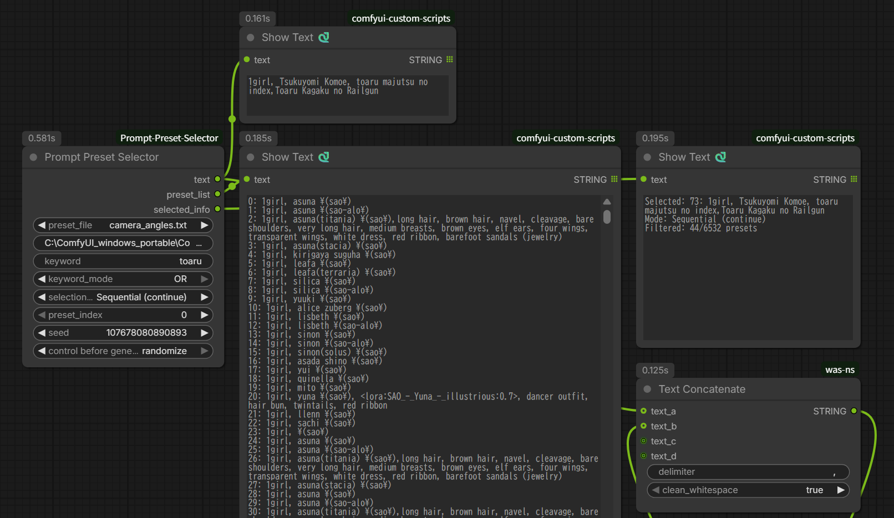
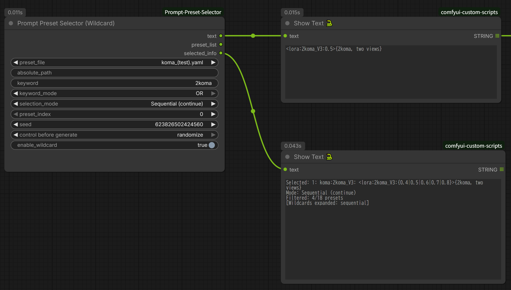
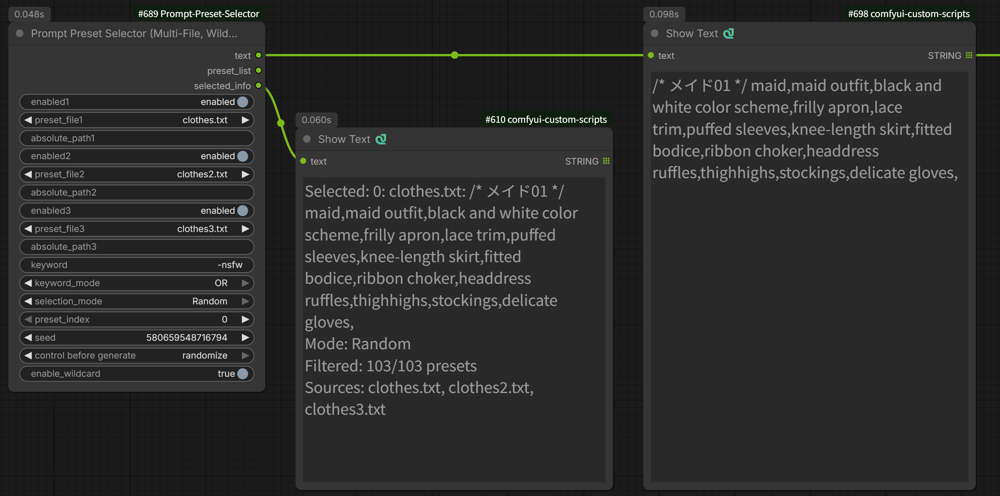
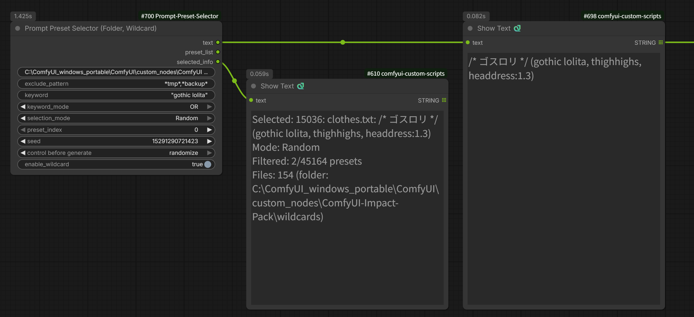

# ComfyUI Prompt Preset Selector

[English](README.md) | [日本語](README_ja.md)

外部ファイルからテキストプリセットを選択できる、柔軟なComfyUIノードです。フィルタリング機能を備え、カメラアングル、服装、ライティング設定、キャラクターデータベースなど、あらゆるテキストベースのプリセット管理に最適です。






## 🆕 v1.4.0の新機能

### keyword出力

全ノードに**`keyword`出力**を追加しました。選ばれたプリセットが実際にマッチしたキーワードを`_`で連結して出力します。ANDモードは全キーワード（`front close-up` → `front_close-up`）、ORモードはマッチしたもの（`front back` → `front`または`back`）、OFFモードは空です。詳しくは[keyword出力](#keyword出力v140)を参照してください。

`keyword`は出力の末尾に追加したので、**既存のワークフローの接続はそのまま使えます**。選ばれるプリセットも以前と同じです。

### 追加テキストと強度

全ノードの下部に3つのウィジェットを追加しました。ON/OFFスイッチ、プリセットの後ろに付け足す**追加テキスト**欄、出力全体を`(text:strength)`形式で囲む**強度**です。詳しくは[追加テキストと強度](#追加テキストと強度v140)を参照してください。

```
プリセット:        masterpiece, 1girl
additional_text:  smile (ON)
strength:         1.5
text出力:          (masterpiece, 1girl, smile:1.5)
```

追加テキスト欄でもワイルドカード（`__filename__`、`{A|B}`、`{__key__|__key__}`）が使えます。

デフォルト（OFF／空／1.0）では出力は変わらないので、既存のワークフローはそのまま動作します。

### ワイルドカードの修正

`__filename__`がエラーも出さずに展開されなかった次のケースを修正しました：

- **サブフォルダ**：`__portrait/lighting__`（v1.3.0のREADMEには記載していましたが、実際には展開されていませんでした）。区切りは`\`でも可
- **日本語などの名前**：`__髪型__`のような非ASCIIのファイル名
- **Impact Packのフォルダ名**：Impact Packが`comfyui-impact-pack`（小文字。Registry／Manager経由でこの名前になることがあります）でインストールされていても、wildcardsフォルダを見つけられるようになりました。これまではLinux / macOSで見つかりませんでした
- **BOM付きUTF-8**：1行目の`# コメント`が無視されるようになりました（プリセットファイル・ワイルドカードファイルとも）
- **行頭に空白があるコメント**：ワイルドカードファイルの`  # コメント`を、プリセットファイルと同じくコメントとして扱います
- **連続したワイルドカード**：`__a____b__`を2つのワイルドカードとして読みます

`presets`／`wildcards`の外を指す`__../xxx__`のような名前は拒否します。通常のワイルドカードの展開結果は以前と同じです。

## v1.3.0の新機能 — サブフォルダ対応

**プリセットのドロップダウンがサブフォルダを読むようになりました。** v1.2.0までは`presets`フォルダと`wildcards`フォルダの直下にあるファイルしかリストに出ませんでした。今後はフォルダで分類して整理し、同じドロップダウンから選択できます：

```
presets/
├── camera_angles.txt          → 「camera_angles.txt」
├── portrait/
│   ├── lighting.txt           → 「portrait/lighting.txt」
│   └── expressions.yaml       → 「portrait/expressions.yaml」
└── landscape/
    └── weather.txt            → 「landscape/weather.txt」
```

あわせて、ドロップダウンの並び順を**大文字小文字を区別しない名前順**に変更しました。直下のファイルが先に並び、その後サブフォルダごとにグループ化されます。従来は文字コード順だったため、大文字始まり・アンダースコア始まり・日本語名のファイルが想定外の位置に飛んで見落としやすくなっていました。

**既存のワークフローに影響はありません。** `presets`直下のファイルは従来通りファイル名のみで表示・保存されます。サブフォルダは任意機能なので、作らなければ何も変わりません。

すでに`presets`や`wildcards`にサブフォルダがあった場合は、その中のファイルが初めてドロップダウンに現れるため、リストが以前より長くなることがあります。

## 機能

- 📁 **外部ファイル管理**: `.txt`、`.yaml`、`.yml`ファイルでプリセットを保存
- 🌐 **絶対パス対応**: システム上のどこにあるファイルでも使用可能
- 📝 **複数のYAML形式対応**: リスト、ネスト辞書、フラット形式に対応
- 🔍 **高度なキーワードフィルタリング**: キーワードの包含・除外、フレーズ検索に対応
- 🏷️ **keyword出力**: 選ばれたプリセットがマッチしたキーワードを、ファイル名などにそのまま使える形で出力
- 🎲 **複数の選択モード**: Manual、Sequential、Sequential (continue)、Random
- 🎰 **Wildcard展開機能**: `{A|B|C}`、`__filename__`、`{__key__|__key__}`構文に対応
- ➕ **追加テキストと強度**: プリセットファイルを編集せずに、テキストの付け足しと出力全体への強度指定が可能
- 🔄 **ComfyUI-Impact-Pack連携**: wildcardsフォルダとの互換性
- 📝 **簡単な編集**: 任意のテキストエディタでプリセットを編集可能（Pythonコードの変更不要）
- 🗂️ **複数のプリセットファイル**: カテゴリ別にプリセットを整理
- 🗃️ **サブフォルダ対応**: フォルダで分類したプリセットをドロップダウンから選択
- 🔀 **複数ファイル横断検索**: 最大3ファイルを同時に検索、各スロットに個別のON/OFFトグル付き
- 📂 **フォルダ検索**: フォルダ配下のプリセットファイルを再帰的に検索、除外パターン指定可
- 💬 **コメント対応**: プリセットファイルにコメントや空行を追加可能
- 🔄 **動的読み込み**: プリセットファイル編集時にComfyUIの再起動不要

## ノード種類

このノードには4つのバージョンがあります：

### Prompt Preset Selector
基本的なプリセット選択機能を提供。Wildcard展開は不要な場合に使用。

### Prompt Preset Selector (Wildcard)
Wildcard展開機能付きバージョン。以下の構文に対応：
- `{A|B|C}` - 選択肢から1つを選択
- `__filename__` - wildcardsフォルダ内のファイルから1行を読み込み
- `{__key__|__key__}` - YAMLファイル内のキーから内容を選択（Impact Pack形式）

### Prompt Preset Selector (Multi-File, Wildcard)
最大3つのプリセットファイルを同時に検索。書式の異なる複数ファイルを手動で1つに統合する必要がありません。各ファイルスロットに個別のON/OFFトグル、ドロップダウン、絶対パス欄を装備。Wildcard構文にフル対応。

### Prompt Preset Selector (Folder, Wildcard)
指定フォルダ配下の`.txt` / `.yaml` / `.yml`ファイルをサブフォルダも含めて再帰的に検索。除外パターンの指定も可能。Wildcard構文にフル対応。

## インストール

1. ComfyUIのカスタムノードディレクトリに移動：
```bash
cd ComfyUI/custom_nodes
```

2. このリポジトリをクローン：
```bash
git clone https://github.com/shin131002/ComfyUI-Prompt-Preset-Selector.git
```

3. （オプション）PyYAMLをインストール（YAML対応用、未インストールの場合）：
```bash
pip install pyyaml
```

注意：PyYAMLは既に環境にインストールされている場合がほとんどです。YAMLファイルが読み込めない場合、ノードが警告を表示します。

4. ComfyUIを再起動

## 使い方

### 基本的な使い方

1. ワークフローに **"Prompt Preset Selector"** または **"Prompt Preset Selector (Wildcard)"** ノードを追加
2. **オプションA**: ドロップダウンからプリセットファイルを選択（例：`camera_angles.txt`）
   **オプションB**: `absolute_path`フィールドに絶対パスを入力（例：`/home/user/my_presets/styles.yaml`）
3. 実行モードを選択
4. `text`出力をプロンプトノードに接続

**注意**: `absolute_path`が指定されている場合、`preset_file`ドロップダウンより優先されます。

### ファイルの場所

プリセットファイルは以下の場所から読み込まれます（優先順位順）：

1. **絶対パス指定** - `absolute_path`フィールドに記入された場合
2. **presetsフォルダ** - `ComfyUI/custom_nodes/ComfyUI-Prompt-Preset-Selector/presets/`
3. **wildcardsフォルダ** - `ComfyUI/custom_nodes/ComfyUI-Impact-Pack/wildcards/`（Impact Packインストール時）

ドロップダウンには、presetsフォルダとwildcardsフォルダの両方のファイルが表示されます（重複は除外）。

#### サブフォルダ

どちらのフォルダも再帰的にスキャンされます。サブフォルダ内のファイルは、そのフォルダからの相対パスで表示されます：

```
presets/portrait/lighting.txt   → 「portrait/lighting.txt」と表示
presets/camera_angles.txt       → 「camera_angles.txt」と表示
```

並び順は直下のファイルが先で、その後サブフォルダごとにまとまります。大文字小文字は区別しません。

`__filename__`形式のwildcard構文でサブフォルダ内のファイルを参照する場合は、フォルダ名を含めて記述します：

```
__portrait/lighting__
```

ファイルを追加してもComfyUIの再起動は不要です。**Refresh Node Definitions**（または`R`キー）でドロップダウンが再構築されます。

### 絶対パスの使用

システム上のどこにあるプリセットファイルでも使用できます：

```
/home/user/presets/camera_angles.txt
/mnt/shared/prompts/styles.yaml
C:\Users\YourName\Documents\presets\lighting.yml  (Windows)
```

対応ファイル形式：`.txt`、`.yaml`、`.yml`

### 複数ファイル・フォルダ検索

プリセットが書式の異なる複数ファイルに分散していると、手動で1ファイルに統合するのは手間がかかります。Multi-File版とFolder版はファイルを統合せず、複数ファイルを横断して検索します。

どちらのノードも各行に「出所ファイル」のプレフィックスを自動付与するため、通常のキーワード検索でファイル単位に絞り込めます。

#### Prompt Preset Selector (Multi-File, Wildcard)

独立した3つのファイルスロットを持ちます。各スロットの構成：

| 項目 | 説明 |
|------|------|
| `enabled{n}` | 設定を消さずにスロットをON/OFF |
| `preset_file{n}` | ドロップダウン（基本版と同じ） |
| `absolute_path{n}` | 絶対パス（そのスロットのドロップダウンより優先） |

各行にはファイル名がプレフィックスとして付きます：

```
colors.txt: red
colors.txt: blue
camera_angles.yaml: camera_angles:close_up: front view, low-angle shot
```

プレフィックスで検索すればファイル単位に絞り込めます：

```
Keyword: colors.txt:
```

インデックスはスロット順（1→2→3）、各ファイル内は元の順序で採番されます。スロットをOFFにするとその行はリストごと消えるため、後続スロットのインデックスがずれます。

#### Prompt Preset Selector (Folder, Wildcard)

`folder_path`配下の`.txt` / `.yaml` / `.yml`ファイルを、サブフォルダも含めてすべて読み込みます。

| 項目 | 説明 |
|------|------|
| `folder_path` | 検索対象フォルダの絶対パス |
| `exclude_pattern` | 除外するglobパターン（カンマ区切り、省略可） |

各行には`folder_path`からの相対パスがプレフィックスとして付くため、別のサブフォルダにある同名ファイルも衝突しません：

```
colors.txt: red
sub/colors.txt: crimson
```

ファイルは相対パスのアルファベット順に読み込まれるため、実行間で`preset_index`が安定します。

##### exclude_patternの書き方

**基本ルール**

- 複数指定する場合の区切りは**カンマまたは改行**。前後の空白は自動で除去されます
- 各パターンはPython標準の`fnmatch`で照合されます
- 各パターンは「`folder_path`からの**相対パス**」と「**ファイル名**」の両方に対して照合され、どちらか一方でも一致すれば除外されます
- **部分一致ではなく完全一致**です。`backup`だけでは何にも一致しません（`*backup*`と書く必要があります）
- 空欄の場合は何も除外されません

**使えるワイルドカード**

| 記号 | 意味 |
|------|------|
| `*` | 0文字以上の任意の文字（**`/`も含む**） |
| `?` | 任意の1文字 |
| `[abc]` | 括弧内のいずれか1文字 |
| `[!abc]` | 括弧内**以外**の1文字 |

**具体例**

以下のフォルダ構成の場合：

```
a.txt
b_backup.txt
notes.yaml
tmp_draft.txt
sub/a.txt
sub/deep/c.txt
Backup/old.txt
```

| パターン | 除外されるファイル |
|----------|--------------------|
| `sub/*` | `sub/a.txt`、`sub/deep/c.txt`（サブ配下ごと） |
| `sub` | 何も除外されない（フォルダ名だけでは一致しない） |
| `*_backup*` | `b_backup.txt` |
| `tmp_*, *_backup*` | `tmp_draft.txt`、`b_backup.txt` |
| `*.yaml` | `notes.yaml` |
| `sub/a.txt` | `sub/a.txt`のみ |
| `*/deep/*` | `sub/deep/c.txt` |
| `?.txt` | `a.txt`、`sub/a.txt`、`sub/deep/c.txt` |

**⚠️ 注意点3つ**

**1. `*`は`/`を跨ぎます**
`*.txt`と書くと直下のファイルだけでなく`sub/deep/c.txt`まで除外されます。`*`がディレクトリ区切りで止まる通常のシェルglobとは異なる挙動です。「`folder_path`直下の`.txt`だけ除外」という指定は現状できません。

**2. ファイル名にも照合されるため、同名ファイルが巻き添えになります**
`a.txt`と指定すると`sub/a.txt`も一緒に除外されます。また「直下の`a.txt`だけを除外」は原理的に指定できません（相対パスとファイル名が同一の文字列になるため）。サブフォルダ側だけを狙う場合は`sub/a.txt`と相対パスをフルで書けば正確に効きます。

**3. 大文字小文字の区別はOSに依存します**
`fnmatch`はOSの慣習に従うため、Linux/macOSでは`backup/*`は`Backup/old.txt`に一致**しません**が、Windowsでは一致**します**。デュアルブート環境などで同じワークフローを共有する場合は注意してください。

**よく使うパターン**

```
*_backup*, *_bak*   → バックアップファイル
tmp_*, *_wip*       → 下書き・作業中ファイル
_archive/*          → アーカイブフォルダごと
*.yml               → 特定拡張子のみ（全階層）
```

#### ファイル横断のYAMLキー参照

両ノードとも`{__key__|__key__}`は読み込んだ**全ファイル**からキーを検索します。別々のYAMLファイルに定義したキー同士でも相互参照できます：

```yaml
# heroes.yaml
heroes:
  - superman, red cape, blue suit

# sidekicks.yaml
sidekicks:
  - robin, red vest, yellow cape

# characters.yaml
characters:
  all:
    - {__heroes__|__sidekicks__}
```

`all`を選択すると、どちらのファイルからも選ばれます。同じトップレベルキーが複数ファイルに存在する場合は、後から読み込まれたファイルが優先されます。

#### 該当プリセットが無い場合の挙動

有効なソースが無い場合（全スロットがOFF、フォルダが空または存在しない、キーワードに一致するプリセットが無い）、ノードは空文字列を出力し、**ワークフローはそのまま継続**します。エラーを投げてキューを止めることはありません。理由は`selected_info`に表示されます。

### Wildcard機能（Wildcard版ノードのみ）

#### enable_wildcardパラメータ
- `true`（デフォルト）: Wildcard構文を展開
- `false`: Wildcard構文をそのままテキストとして出力

基本的に`true`のままで問題ありません。Wildcard記法がない場合は何も起きず、通常通りテキストが出力されます。

#### サポートされるWildcard構文

##### 1. 選択肢展開: `{A|B|C}`
```
{red|blue|green} dress
→ "red dress"、"blue dress"、または "green dress"
```

ネスト対応：
```
{red|{dark|light} blue} dress
→ "red dress"、"dark blue dress"、または "light blue dress"
```

##### 2. ファイル参照: `__filename__`
`presets/colors.txt` または `wildcards/colors.txt` の内容を参照：
```
__colors__ dress
→ colors.txtの1行をランダムに選択して展開
```

ファイル検索順序：
1. `presets/colors.txt`
2. `wildcards/colors.txt`（presetsになければ）

名前のルール：
- `.txt`を付けずに書きます。対象は`.txt`ファイルのみです（`.yaml`は対象外）
- サブフォルダ内のファイルはフォルダ名を含めて書きます：`__portrait/lighting__`（`\`区切りも可）
- 使える文字は英数字・`_`・`-`・`.`と、日本語などの非ASCII文字です。スペースやその他の記号は使えません
- Linux / macOSでは大文字小文字を区別します
- `..`やドライブ指定は使えません。参照できるのは`presets`と`wildcards`の中だけです
- ファイルはUTF-8で保存してください（BOMの有無は問いません）。行頭が`#`の行はコメントです（前に空白があっても可）

##### 3. YAMLキー選択: `{__key1__|__key2__}`
YAMLファイル内のキーから内容を選択（Impact Pack形式）：

```yaml
characters:
  heroes:
    - superman, cape, blue suit
    - batman, dark costume, mask
  villains:
    - joker, purple suit, green hair
    - riddler, question mark, green suit
```

使用例：
```
{__heroes__|__villains__}
→ heroesまたはvillainsキーの内容から1つを選択
```

**重要**: この構文は、選択されたプリセットファイル内のキーを参照します。

#### Selection Modeとwildcard展開の関係

| selection_mode | プリセット選択 | wildcard展開 |
|---|---|---|
| Manual | preset_indexで指定 | ランダム（seedベース） |
| Random | ランダム（seedベース） | ランダム（seedベース） |
| Sequential | preset_indexから順番 | シーケンシャル |
| Sequential (continue) | 前回の続きから | シーケンシャル |

**シーケンシャル展開**: wildcardの選択肢を順番に使用（次回実行時は次の選択肢）
**ランダム展開**: seedに基づいて毎回選択

### YAMLファイル形式

このノードは3つのYAML形式に対応しています：

#### 形式A: プリセットリスト
```yaml
presets:
  - front view, low-angle shot, close-up
  - back view, low-angle shot, close-up
  - side view, eye-level shot, medium shot
```

#### 形式B: フラットリスト
```yaml
- front view, low-angle shot, close-up
- back view, low-angle shot, close-up
- side view, eye-level shot, medium shot
```

#### 形式C: ネスト辞書
```yaml
camera_angles:
  close_up:
    - front view, low-angle shot, close-up
    - back view, low-angle shot, close-up
  wide_shot:
    - front view, high-angle shot, wide shot
    - back view, high-angle shot, wide shot

lighting:
  natural:
    - golden hour lighting, warm tones
    - overcast daylight, diffused light
  studio:
    - three-point lighting, neutral balance
```

**重要**: 形式Cでは、キー階層が各プリセットの先頭に追加されます：
- 結果：`camera_angles:close_up: front view, low-angle shot, close-up`
- これにより、キーで検索可能：`camera_angles:`、`close_up:`、`"camera angles":"close up"`
- スペースを含むキーはYAMLでクォートが必要：`"camera angles":`

すべての形式は自動的に単一のプリセットリストに変換されます。

### 実行モード

**Manual**
- `preset_index`を直接使用
- 特定のプリセットのテスト用

**Sequential**
- `preset_index`から開始、実行ごとにインクリメント
- ワークフロー再読み込み時に`preset_index`にリセット

**Sequential (continue)**
- 実行間で最後の位置から継続
- ワークフロー再読み込みまで状態を保持
- バッチ生成に便利

**Random**
- `seed`に基づいてランダムにプリセットを選択
- 同じseed = 同じ結果（再現可能）

### キーワードフィルタリング

キーワード検索でプリセットをフィルタ：

#### 基本モード
- **OFF**: フィルタなし（全プリセットを使用）
- **AND**: すべてのキーワードに一致
- **OR**: いずれかのキーワードに一致

#### 構文

**シンプルなキーワード**:
```
front                → "front"を含む行
front close-up       → AND: "front" かつ "close-up"
front, back          → OR: "front" または "back"
```

**フレーズ検索**（ダブルクォート使用）:
```
"low-angle shot"     → 完全フレーズに一致
front "eye-level"    → フレーズと単語の組み合わせ
```

**YAML キー階層検索**:

ネスト辞書を使用する場合、キーがプリセットテキストの先頭に追加されます：
```yaml
camera_angles:
  close_up:
    - front view, low-angle shot, close-up
```
結果：`camera_angles:close_up: front view, low-angle shot, close-up`

キーで検索：
```
camera_angles:              → camera_angles配下のすべてのプリセット
close_up:                   → 任意の階層のclose_upキー
camera_angles:close_up:     → 完全パス（ANDモードでスペース区切り）
"camera angles":            → スペースを含むキー（クォート使用）
"camera angles" "close up"  → 両方のキーが存在（ANDモード）
```

**⚠️ Wildcard選択肢の除外方法**:

ネストYAML構造でwildcard選択肢（`{__key1__|__key2__}`）を含む行がキーワード検索に引っかかる場合：

```yaml
characters:
  all:
    - {__heroes__|__villains__}
  heroes:
    - superman, cape, blue suit
  villains:
    - joker, purple suit
```

キーワード「heroes」で検索すると、`all`行も含まれてしまいます（wildcard内に「heroes」が含まれるため）。

**解決策**: コロン `:` を含めて検索
```
キーワード: heroes:
```

これにより、キー階層として検索され、wildcard選択肢の行は除外されます：
- ❌ `all: {...}` → マッチしない（「heroes:」という形式ではない）
- ✅ `heroes: superman, cape...` → マッチする

**その他の方法**:
```
キーワード: heroes -all
```
除外キーワードを使って`all`を明示的に除外。

**除外**（マイナス接頭辞使用）:
```
front -wide          → "front"を含み、"wide"を除外
front -wide -medium  → 複数の除外
-wide -back          → 除外のみ（すべてから削除）
"front view" -"wide shot" → フレーズによる除外
camera_angles: -wide_shot:  → キーフィルタ + キー除外
```

#### フィルタリング規則
- キーワードは**大文字小文字を区別しない**
- 除外は**OR論理**を使用（いずれかに一致で除外）
- 除外は包含フィルタリングの**後**に適用
- **記述の順序は関係なし**: `front -wide` = `-wide front`
- 区切り文字：カンマ`,`またはスペース
- **YAML辞書キーは検索可能**: キーマッチングには`:`接尾辞を使用（例：`close_up:`）
- **キー内のスペース**: ダブルクォート使用（例：`"camera angles":`）

#### 例

| キーワード | モード | 結果 |
|---------|------|--------|
| `front close-up -wide` | AND | "front" かつ "close-up"を含み、"wide"を含まない |
| `front back -medium` | OR | "front" または "back"を含み、"medium"を含まない |
| `"front view" -"wide shot"` | AND | フレーズ "front view"を含み、フレーズ "wide shot"を含まない |
| `-wide` | OFF | "wide"を含まないすべての行 |
| `camera_angles:` | AND | camera_anglesキー配下のすべてのプリセット（YAML） |
| `"close up":` | AND | "close up"キーを持つすべてのプリセット（YAML、キー内スペース） |
| `lighting: -dramatic:` | AND | lightingキーのプリセット、dramaticキーを除外 |
| `heroes:` | AND | heroesキーのみ（wildcard選択肢`{__heroes__|...}`を除外） |

#### keyword出力（v1.4.0）

選ばれたプリセットが実際にマッチしたキーワードを、`_`で連結したテキストで出力します（全ノード共通、出力の末尾）。

| キーワード | モード | 選ばれた行 | `keyword`出力 |
|---------|------|--------|--------|
| `front close-up` | AND | `front view, close-up` | `front_close-up` |
| `front back` | OR | `front view, close-up` | `front` |
| `front back` | OR | `back view, wide shot` | `back` |
| `"front view" close-up` | AND | `front view, close-up` | `front_view_close-up` |
| `front -wide` | AND | `front view, close-up` | `front` |
| `camera_angles:close_up:` | AND | `camera_angles:close_up: front view` | `camera_angles_close_up` |
| `front` | OFF | （どれでも） | （空） |

- フレーズ内のスペースも`_`になります
- 除外キーワード（`-wide`など）は出力に含みません
- YAMLキー検索の`:`は`_`に置き換え、末尾の`:`は外します（ファイル名に使えるように）
- ORモードで、選ばれた行が複数のキーワードを含む場合は、すべて入力順に連結します（例：`front_back`）
- 大文字小文字は入力どおりに出力します（マッチの判定自体は区別しません）
- Multi-File版・Folder版では、行の先頭に付くファイル名（`angles.txt: `など）もマッチの対象です
- `keyword_mode`がOFFのとき、包含キーワードが無いとき、該当するプリセットが無いときは空文字です

### 追加テキストと強度（v1.4.0）

全ノードの下部にある3つのウィジェットです：

| パラメータ | 型 | 説明 |
|-----------|------|-------------|
| `enable_additional_text` | ブール値 | `additional_text`のON/OFF（デフォルト：OFF） |
| `additional_text` | 文字列（複数行） | ON時、`プリセット, 追加テキスト`の形でプリセットの後ろに追加 |
| `strength` | 小数 | 出力全体を`(text:strength)`形式で囲む。デフォルト1.0で変更なし（範囲0〜10） |

処理順：プリセット選択 → ワイルドカード展開 → 追加テキスト（追加テキスト内のワイルドカードも展開） → 強度

**additional_textのルール**
- 行頭が`#`の行はコメントとして無視します（前に空白があっても可）。行の途中の`#`はそのまま出力します
- 空行は無視し、残りの行は`, `で連結します
- プリセットや各行の末尾のカンマは除去してから連結するので、`,,`にはなりません
- すべての行がコメントの場合は、何も追加しません
- スイッチをOFFにしても欄の内容は残るので、実行ごとに切り替えられます

**additional_text内のワイルドカード**
- `__filename__`、`{A|B|C}`、`{__key__|__key__}`を、プリセットと同じルールで展開します。`enable_wildcard`と`selection_mode`に従います
- ランダム選択には`seed`から派生したシードを使います。同じseedなら同じ結果になりますが、プリセット側のワイルドカードとは独立に選ばれます（両方にある`{red|blue}`が必ず同じ側になる、ということはありません）
- Sequentialモードでは、追加テキスト側のワイルドカードも実行ごとに順番に切り替わります
- `{__key__|__key__}`は、選択中のYAMLプリセットファイルのキーを参照します（Multi-File版・Folder版では読み込んだ全ファイル）
- コメント行は展開の前に除去するので、コメントアウトしたワイルドカードは何の影響もありません
- 基本版の"Prompt Preset Selector"は、プリセットと同じく追加テキストのワイルドカードも展開しません

```
# メモ：季節ごとの追加
smile,
  # blue sky   ← 無視される
cherry blossoms
```
→ `masterpiece, 1girl, smile, cherry blossoms`

**strengthのルール**
- 1.0のときは出力を変えません
- ComfyUIのプロンプト構文ではネストした強度は掛け算になるため、プリセット内の強度にも掛かります：`(red:1.2), dress`にstrength 1.5 → redは1.8、dressは1.5
- 出力が空のときは適用しません

適用したときは、`selected_info`に`[Additional text appended]`／`[Wildcards expanded in additional text]`／`[Strength: 1.5]`と表示します。`keyword`出力には影響しません。

### カスタムプリセットの作成

#### テキストファイル (.txt)

1. このノードディレクトリの`presets`フォルダに移動
2. 新しい`.txt`ファイルを作成（例：`my_presets.txt`）
3. プリセットを1行ずつ追加：

```txt
# これはコメントです - 無視されます

front view, low-angle shot, close-up
side view, eye-level shot, medium shot
back view, high-angle shot, wide shot

# 別のセクション
overhead view, bird's-eye view, establishing shot
```

#### YAMLファイル (.yaml / .yml)

構造化されたプリセットファイルをYAMLで作成：

```yaml
# ネスト辞書形式
camera_angles:
  close_up:
    - front view, low-angle shot, close-up
    - side view, low-angle shot, close-up
  
  medium_shot:
    - front view, eye-level shot, medium shot
    - side view, eye-level shot, medium shot
```

またはシンプルなリスト形式：

```yaml
presets:
  - front view, low-angle shot, close-up
  - side view, eye-level shot, medium shot
```

4. ComfyUIをリフレッシュまたは再起動
5. 新しいプリセットファイルがドロップダウンに表示されます

## プリセットファイル形式

### テキストファイル (.txt)
- **1行に1プリセット**
- **`#`で始まる行はコメント**（無視されます）
- **空行は無視**
- **UTF-8エンコーディング**対応（日本語などの国際文字）

### YAMLファイル (.yaml, .yml)
- **3つの対応形式**: プリセットリスト、フラットリスト、ネスト辞書
- **すべての形式が単一のプリセットリストに変換**されます
- **コメント対応**（`#`使用）
- **UTF-8エンコーディング**対応

## ノードパラメータ

### Prompt Preset Selector（基本版）

| パラメータ | 型 | 説明 |
|-----------|------|-------------|
| `preset_file` | ドロップダウン | presetsまたはwildcardsディレクトリから使用するファイルを選択 |
| `absolute_path` | 文字列 | オプション：プリセットファイルへの絶対パス（preset_fileより優先） |
| `keyword` | 文字列 | フィルタリング用キーワード（フレーズと除外に対応） |
| `keyword_mode` | ドロップダウン | フィルタモード：OFF、AND、OR |
| `selection_mode` | ドロップダウン | プリセットの選択方法：Manual、Sequential、Sequential (continue)、Random |
| `preset_index` | 整数 | Manual/Sequentialモードの開始インデックス（0始まり） |
| `seed` | 整数 | 再現可能なランダム選択用のランダムシード |

### Prompt Preset Selector (Wildcard)（Wildcard版）

基本版のすべてのパラメータに加えて：

| パラメータ | 型 | 説明 |
|-----------|------|-------------|
| `enable_wildcard` | ブール値 | wildcard展開のON/OFF（デフォルト：true） |

### Prompt Preset Selector (Multi-File, Wildcard)（複数ファイル版）

| パラメータ | 型 | 説明 |
|-----------|------|-------------|
| `enabled1` / `enabled2` / `enabled3` | ブール値 | 各ファイルスロットのON/OFF（デフォルト：true） |
| `preset_file1` / `preset_file2` / `preset_file3` | ドロップダウン | 各スロットのファイル選択 |
| `absolute_path1` / `absolute_path2` / `absolute_path3` | 文字列 | 各スロットの絶対パス（そのスロットのドロップダウンより優先） |
| `keyword` | 文字列 | フィルタ用キーワード（結合後のリスト全体に適用） |
| `keyword_mode` | ドロップダウン | フィルタモード：OFF、AND、OR |
| `selection_mode` | ドロップダウン | Manual、Sequential、Sequential (continue)、Random |
| `preset_index` | 整数 | 結合後リストの開始インデックス（0始まり） |
| `seed` | 整数 | ランダム選択用シード |
| `enable_wildcard` | ブール値 | wildcard展開のON/OFF（デフォルト：true） |

### Prompt Preset Selector (Folder, Wildcard)（フォルダ版）

| パラメータ | 型 | 説明 |
|-----------|------|-------------|
| `folder_path` | 文字列 | 検索対象フォルダの絶対パス（サブフォルダも含む） |
| `exclude_pattern` | 文字列 | 除外するglobパターン（カンマ区切り、例：`*_backup*, tmp_*`） |
| `keyword` | 文字列 | フィルタ用キーワード（結合後のリスト全体に適用） |
| `keyword_mode` | ドロップダウン | フィルタモード：OFF、AND、OR |
| `selection_mode` | ドロップダウン | Manual、Sequential、Sequential (continue)、Random |
| `preset_index` | 整数 | 結合後リストの開始インデックス（0始まり） |
| `seed` | 整数 | ランダム選択用シード |
| `enable_wildcard` | ブール値 | wildcard展開のON/OFF（デフォルト：true） |

### 全ノード共通パラメータ（v1.4.0）

| パラメータ | 型 | 説明 |
|-----------|------|-------------|
| `enable_additional_text` | ブール値 | `additional_text`のON/OFF（デフォルト：OFF） |
| `additional_text` | 文字列 | ON時、出力に追加するテキスト。行頭`#`はコメント。ワイルドカードも展開 |
| `strength` | 小数 | 出力全体を`(text:strength)`形式で囲む。デフォルト1.0で変更なし |

[追加テキストと強度](#追加テキストと強度v140)を参照してください。

## ノード出力

| 出力 | 型 | 説明 |
|--------|------|-------------|
| `text` | STRING | 選択されたプリセットテキスト（wildcard展開後、追加テキストと強度を適用） |
| `preset_list` | STRING | すべての利用可能なプリセットの番号付きリスト（参照用） |
| `selected_info` | STRING | 選択の詳細（インデックス、モード、フィルタ統計、wildcard展開情報） |
| `keyword` | STRING | 選ばれたプリセットが実際にマッチしたキーワード（`_`で連結、v1.4.0）。[keyword出力](#keyword出力v140)を参照 |

## 使用例

### Wildcard活用例

#### 動的キャラクター選択
```yaml
characters:
  all_characters:
    - {__heroes__|__villains__|__sidekicks__}
  heroes:
    - superman, red cape, blue suit
    - batman, dark costume, utility belt
  villains:
    - joker, purple suit, green hair
  sidekicks:
    - robin, red vest, yellow cape
```

`all_characters`を選択すると、3つのカテゴリからランダムに選択され、さらにそのカテゴリ内からキャラクターが選択されます。

#### 色とスタイルの組み合わせ
presetsフォルダに`colors.txt`を作成：
```txt
red
blue
green
yellow
```

プリセット：
```
__colors__ {dress|suit|jacket}
→ "red dress"、"blue suit"、"green jacket"など
```

### プロンプトライブラリとして使用

過去に生成した良い画像のプロンプトをキー付きで保存・再利用：

```yaml
portraits:
  "girl_soft_lighting_20250115": masterpiece, best quality, 1girl, soft lighting, gentle smile, pastel colors, bokeh background, natural pose, detailed eyes, flowing hair
  "boy_dramatic_20250116": high contrast, 1boy, dramatic lighting, intense gaze, dark background, cinematic composition, sharp focus
  "fantasy_elf_20250117": fantasy art, elf girl, pointed ears, ethereal beauty, magic glow, forest background, detailed costume

landscapes:
  "sunset_beach_20250114": beautiful sunset, golden hour, ocean waves, dramatic sky, vibrant colors, peaceful atmosphere, photorealistic
  "cyberpunk_city_20250115": cyberpunk cityscape, neon lights, rain reflections, futuristic architecture, night scene, highly detailed

experimental:
  "abstract_colors_20250113": abstract art, vibrant colors, flowing shapes, dreamlike, artistic composition
```

**活用例**:
- `"girl_soft_lighting_20250115":` → 特定のプロンプト全文を呼び出し
- `portraits:` + Sequential → ポートレート系プロンプトを順番に試す
- `portraits:` + Random → 過去のポートレート作品からランダムに選択
- `lighting -dramatic` → "lighting"を含み、"dramatic"を含まないプロンプト

**メリット**:
- ✅ 成功したプロンプトを日付付きで記録
- ✅ 同じ設定で別バリエーションを簡単に生成
- ✅ 何が良かったか後から振り返りやすい
- ✅ チームで良いプロンプトを共有可能

過去の良い結果を体系的に管理し、創作活動を効率化できます！

### カメラアングルバリエーション
フィルタリングを使用してカメラアングルのバリエーションを体系的に生成：
```
Keyword: "close-up" -back
Mode: Sequential
→ バックビューを除くすべてのクローズアップショットを順番に選択
```

### アニメキャラクターデータベース
シリーズ別にキャラクタープロンプトを整理：
```yaml
anime:
  shonen:
    - luffy, straw hat, scar under eye, determined expression
    - naruto, blonde hair, whisker marks, orange jacket
    - goku, spiky black hair, orange gi, martial arts pose
  seinen:
    - spike spiegel, green hair, brown suit, cigarette
    - guts, black armor, huge sword, intense gaze
  slice_of_life:
    - yui hirasawa, brown hair, school uniform, guitar
```

**検索例**:
- `anime:` → すべてのアニメキャラクター
- `shonen:` → 少年漫画キャラクターのみ
- `shonen: -naruto` → NARUTO以外の少年漫画キャラクター
- `blonde -naruto` → NARUTO以外の金髪キャラクター
- `"slice_of_life":` → 日常系キャラクターのみ

特定のカテゴリからランダムに選択したい大規模なキャラクターデータベース管理に最適です！

### YAMLベースのスタイルライブラリ
複雑なスタイル階層を整理：
```yaml
styles:
  anime:
    - vibrant colors, bold outlines, expressive eyes
    - pastel tones, soft shading, cute aesthetic
  
  realistic:
    - photographic quality, detailed textures
    - high dynamic range, natural lighting
  
  artistic:
    - watercolor effect, soft edges, dreamy atmosphere
    - oil painting style, thick brushstrokes, rich colors
```

### 共有プリセットの絶対パス
チーム共有のプリセットファイルを使用：
```
absolute_path: /mnt/shared/company_presets/brand_styles.yaml
keyword: professional
→ 一元化されたプリセットライブラリにアクセス
```

### LoRA組み合わせ
```txt
<lora:style1:0.8>, anime style, vibrant colors
<lora:style2:1.0>, realistic, detailed
<lora:style3:0.9>, watercolor, soft edges
```

**注意**: このノードはLoRA構文を通常のテキストとして出力します。実際にLoRAを読み込んで適用するには、出力を`<lora:name:weight>`構文を解析できるLoRA対応ノードに接続してください。このノード自体はLoRA構文を処理せず、単にテキストを後段のノードに提供するだけです。

## ヒント

### preset_list出力の使用
`preset_list`を表示ノードに接続して、インデックス付きのすべての利用可能なプリセットを確認。用途：
- キーワードに一致するプリセットの確認
- 正しい`preset_index`値の検索
- フィルタ結果の検証

### selected_info出力の使用
実行の詳細を表示：
```
Selected: 5: front view, eye-level shot, close-up
Mode: Sequential (continue)
Filtered: 24/96 presets
[Wildcards expanded: sequential]
```

### バッチ生成
キーワードフィルタリングとSequential (continue)モードを使用：
1. キーワードフィルタを設定（例：`"close-up" -back`）
2. Sequential (continue)モードを選択
3. 複数の生成をキューに追加
→ 各生成で次の一致するプリセットを使用

### 再現可能な結果
ランダム選択の場合：
1. Randomモードを使用
2. 良い結果が得られたらseed値をメモ
3. 同じseedを使用して完全に再現

### Wildcard使用のコツ
- `enable_wildcard=true`を推奨（wildcard記法がなければ通常通り動作）
- Sequential modeでwildcardもシーケンシャルに展開
- `{__key__|__key__}`は同じYAMLファイル内のキーを参照（Multi-File版・Folder版では読み込んだ全ファイルを横断検索）
- `__filename__`はpresetsとwildcardsフォルダの両方を検索
- 追加テキスト欄でもwildcardが使える。プリセットは固定のまま、付け足す部分だけをランダムにしたいときに便利

### 複数ファイル・フォルダ検索のコツ
- `enabled{n}`トグルを使えば、パスを入力し直さずにファイル組み合わせのA/Bテストが可能
- プレフィックス（`colors.txt:`、`sub/`など）で検索すると、特定のファイルやサブフォルダに絞り込める
- バックアップや下書き、メモをプールに含めたくない場合は`exclude_pattern`を活用
- インデックスはフィルタ後のリストに対して採番されるため、有効なファイルを変えると`preset_index`の指す先がずれる。安定したインデックスが必要ならキーワードで範囲を固定する

## トラブルシューティング

**Q: プリセットのドロップダウンが空？**
A: このノードは整数の`preset_index`を使用し、テキストドロップダウンではありません。`preset_list`出力で利用可能なプリセットを確認してください。

**Q: キーワードが機能しない？**
A: `keyword_mode`がOFFではなく、ANDまたはORに設定されていることを確認してください。キーワードがプリセットファイルの実際のテキストと一致するか確認してください。

**Q: Sequential (continue)モードが継続しない？**
A: このモードはワークフローの再読み込み時にリセットされます。状態はアクティブなワークフロー実行中のみ保持されます。

**Q: 除外が機能しない？**
A: マイナス接頭辞を使用していることを確認：`-wide`（`- wide`ではない）。マイナスの後にスペースなし。

**Q: YAMLファイルが読み込まれない？**
A: PyYAMLがインストールされていることを確認：`pip install pyyaml`。YAML構文が有効か確認してください。ノードは3つの形式に対応（YAML形式セクション参照）。

**Q: 絶対パスが機能しない？**
A: 
- ファイルが指定されたパスに存在するか確認
- Windowsでもフォワードスラッシュ`/`を使用（またはバックスラッシュをエスケープ`\\`）
- ファイルが対応する拡張子を持つか確認：`.txt`、`.yaml`、`.yml`
- ファイルの読み取り権限があるか確認

**Q: Wildcardが展開されない？**
A: 
- `enable_wildcard`が`true`になっているか確認
- Wildcard対応のノードを使用しているか確認（基本版の"Prompt Preset Selector"はwildcardを展開しません）
- `__filename__`の場合、ファイルがpresetsまたはwildcardsフォルダに存在するか確認
- `{__key__|__key__}`の場合、キーが選択されたYAMLファイル内に存在するか確認
- ComfyUIのコンソールを確認：`Wildcard file not found`や`Error reading wildcard file`が出ていれば、ファイルが見つからないか読めていません。何も出ていなければ、名前自体が認識されていません（スペースや使えない記号を含んでいる）
- サブフォルダ内のファイルは、フォルダ名を含めて書く：`__portrait/lighting__`
- ファイルはUTF-8で保存する。Shift-JIS（CP932）やUTF-16のファイルは読めません
- Linux / macOSでは名前の大文字小文字を区別します：`__Colors__`では`colors.txt`は見つかりません
- `__filename__`の対象は`.txt`のみです。同名の`.yaml`は使われません
- `absolute_path`で読み込んだプリセットと同じフォルダは検索しません。wildcard用のファイルは`presets`か`wildcards`に置いてください

**Q: 追加テキストや強度が反映されない？**
A: `enable_additional_text`がONか、欄に`#`で始まらない行が1行以上あるかを確認してください。強度は1.0以外で、かつ出力が空でないときだけ適用されます。何が適用されたかは`selected_info`に表示されます。

**Q: Wildcard選択肢がフィルタに含まれてしまう？**
A: キーワードにコロン`:`を付けて検索してください。例：`heroes:`ではなく`heroes`で検索すると、`{__heroes__|...}`もマッチしてしまいます。コロンを付けることでキー階層として検索され、wildcard選択肢を除外できます。

**Q: 追加したプリセットファイルがドロップダウンに出てこない？**
A: リストはComfyUIがノード定義を取得するたびに再構築されるため、再起動は不要です。**Refresh Node Definitions**（または`R`キー）を実行してください。それでも出ない場合は、拡張子が`.txt`、`.yaml`、`.yml`のいずれかか確認してください。また、並び順は直下のファイルが先でサブフォルダは後ろにまとまるため、サブフォルダ内のファイルは他と離れた位置に表示されます。

**Q: Multi-File版・Folder版でプロンプトが空になる／何も生成されない？**
A: まず`selected_info`を確認してください。これらのノードは有効なソースが無い場合、エラーを出さずに空文字列を返してワークフローを継続する設計です。よくある原因：`enabled{n}`が全てOFF、`folder_path`が存在しない、`exclude_pattern`が全ファイルに一致した、キーワードで全プリセットが除外された。

**Q: Folder版がサブフォルダ内のファイルを見つけてくれない？**
A: サブフォルダはデフォルトで再帰検索されます。対応拡張子（`.txt`、`.yaml`、`.yml`）かどうか、`exclude_pattern`に一致していないかを確認してください。パターンは相対パスとファイル名の両方に対して照合されます。

**Q: preset_indexが以前と違うプリセットを指す？**
A: インデックスは結合・フィルタ後のリストに対して採番されます。スロットのON/OFF、フォルダへのファイル追加、キーワードの変更はいずれも採番をずらします。安定させたい場合はキーワードのプレフィックス（例：`colors.txt:`）で範囲を固定してください。

**Q: Folder版で同名ファイルがある場合は？**
A: プレフィックスに`folder_path`からの相対パスを使うため、`colors.txt`と`sub/colors.txt`は区別されます。Multi-File版はファイル名のみをプレフィックスにするため、別フォルダの同名ファイルは同じプレフィックスになります。

**Q: YAMLネスト辞書の順序が違う？**
A: Python辞書は挿入順序を維持（Python 3.7+）しますが、変換処理は構造を走査します。順序はYAML構造の走査に依存します。

## 免責事項とサポートポリシー

### 免責事項

- このノードは**技術サポートなし**で提供されます
- 機能の保証はありません
- 将来のComfyUIアップデートとの互換性は保証されません
- バグレポートや機能リクエストに対応しない場合があります
- 自己責任で使用してください

### サポート状況

- ❌ issueやメールでの個別サポートなし
- ❌ バグ修正や機能追加の保証なし
- ✅ コードはオープンソース - 自由にフォーク・修正可能
- ✅ コミュニティディスカッション歓迎（返答の約束なし）

### 問題の報告

サポートは保証されませんが、以下が可能です:
1. リポジトリの既存issueを確認
2. このREADMEとトラブルシューティングセクションを確認
3. issueを開く（対応されない場合があります）
4. 自分でフォークして修正

## ライセンス

MIT License - 自由に使用、変更、配布できます。
